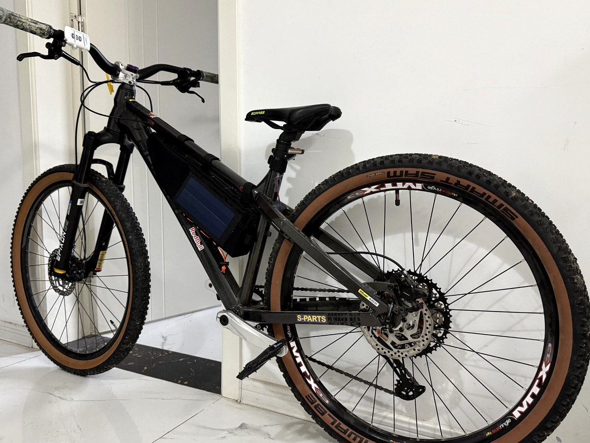
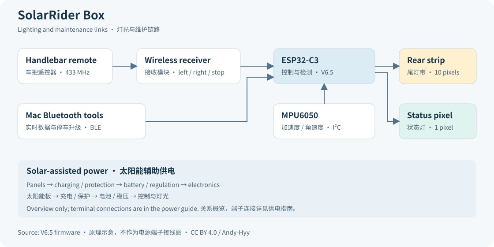

# SolarRide

[English](README.md) · [制作指南](docs/zh-CN/assembly.md) · [固件说明](docs/zh-CN/firmware.md) · [问题反馈](https://github.com/Andy-Hyy/SolarRide/issues)

SolarRide 是一个可自行制作的自行车包灯光项目，结合无线转向提示、惯性传感器触发的刹车提示灯，以及太阳能辅助充电。ESP32-C3 控制尾部的 10 颗灯珠和一颗状态灯，车把遥控器用于选择左转、右转或常规模式。

这里提供固件、电路板源文件、外壳模型和 Mac 蓝牙工具，方便你制作自己的版本、了解它的工作方式，并继续改进。

## 可以做什么

- 常规模式显示红色流动灯效，左右转向显示黄色流水灯。
- 根据减速信号触发刹车提示，触发期间优先显示刹车灯效。
- 状态灯显示校准、正常运行、转向和传感器异常等状态。
- 通过 USB 或 BLE 读取实时数据，提供停车维护时使用的蓝牙固件更新实现。
- 采用模块化 PCB，提供螺丝固定和抽拉外框两种外壳设计。

当前源码为 V6.5。已有实物完成 USB 烧录、左转/右转/停止控制，以及基础推车刹停灯效复测。道路表现、蓝牙升级与恢复全过程、太阳能充电表现和续航仍需进一步测量。采购材料已识别 CN3163 充电板、3.7 V/1200 mAh 电池、5 V 升压款、1 W/6 V 光伏板和灯光器件；[供电指南](docs/zh-CN/power-wiring.md)已记录完整端子关系：CN3163 太阳能充电和 4056-TP USB 充电共接电池，4056-TP 输出接 XR2981 升压到 5 V。

这是辅助照明小制作，不控制自行车的机械刹车；使用时仍应保留正常车灯和手势提示。当前刹车灯效约为 10 Hz 闪烁，实际使用前请检查灯效和安装方式是否合适。

## 从这里开始

1. 阅读[零件与接线说明](docs/zh-CN/hardware.md)和[组装指南](docs/zh-CN/assembly.md)。
2. 设置本地私有蓝牙配对码，再[编译与烧录固件](docs/zh-CN/firmware.md)。
3. [校准安装方向](docs/zh-CN/calibration.md)，静止检查遥控操作和灯光方向。
4. 按[使用指南](docs/zh-CN/operation.md)操作，需要时使用[蓝牙工具](docs/zh-CN/bluetooth.md)。

## 文件目录

| 文件夹 | 内容 |
| --- | --- |
| `firmware/` | V6.5 Arduino 程序和编译配置 |
| `hardware/pcb/` | EasyEDA Pro 工程及已有 PCB1 Gerber/钻孔文件 |
| `hardware/enclosure/` | STEP 外壳原始模型 |
| `tools/` | 配对配置、编译与回归检查工具 |
| `tools/macos/` | 蓝牙数据读取与升级工具源码 |
| `tests/` | 主机回归程序和去除隐私后的特定安装数据 |
| `docs/en/`、`docs/zh-CN/` | 英文与中文制作指南 |

仓库不分发现用设备的私有配对码或预编译固件，请自行编译设备专用镜像。

其他说明包括[采购参考](docs/zh-CN/parts-reference.md)、[设计](docs/zh-CN/design.md)、[外壳](docs/zh-CN/enclosure.md)、[核验与限制](docs/zh-CN/testing.md)、[排障](docs/zh-CN/troubleshooting.md)、[后续改进](docs/zh-CN/roadmap.md)和[许可](docs/zh-CN/licensing.md)。

## 参与改进

欢迎分享制作反馈、补充说明、替换器件经验和具体改进。请阅读[贡献指南](CONTRIBUTING.md)、[交流约定](CODE_OF_CONDUCT.md)和[安全报告](SECURITY.md)。维护者为 [Andy-Hyy](https://github.com/Andy-Hyy)。

## 开源许可

| 材料 | 许可 |
| --- | --- |
| 原创软件 | [MIT](LICENSES/MIT.txt) |
| 原创电路和外壳设计 | [CERN-OHL-P-2.0](LICENSES/CERN-OHL-P-2.0.txt) |
| 文档、原创示意图与数据 | [CC BY 4.0](LICENSES/CC-BY-4.0.txt) |

各类文件范围见 [LICENSE](LICENSE)，依赖库条款见[第三方说明](THIRD_PARTY_NOTICES.md)。
