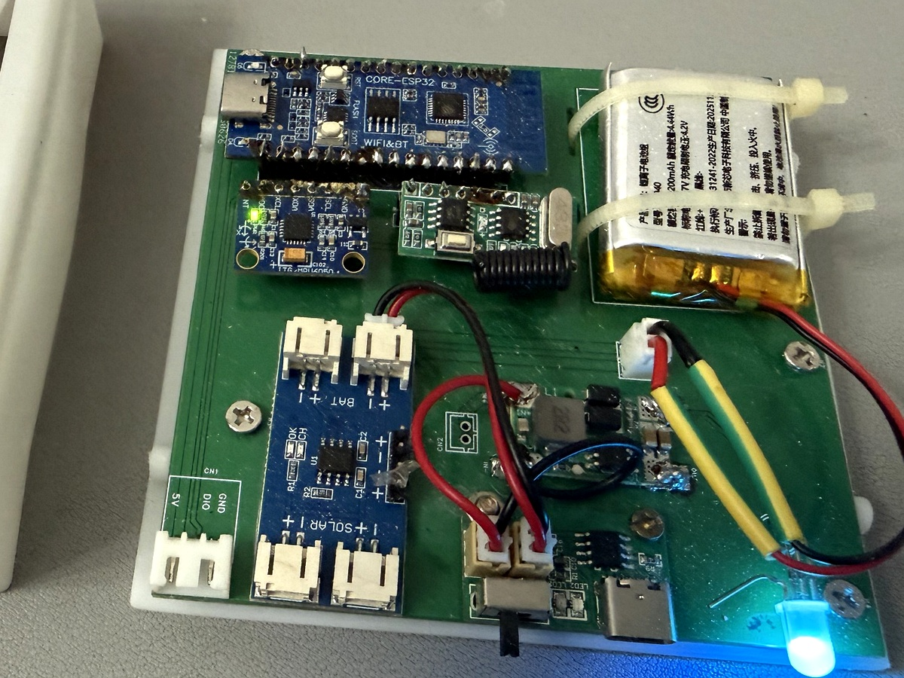

# Parts, power and wiring

[中文](../zh-CN/hardware.md) · [Home](../../README.md)

| Item | Qty | On this build |
| --- | --- | --- |
| ESP32-C3 classic development board | 1 | Headers already soldered. Board target AirM2M_CORE_ESP32C3, 4 MB flash |
| GY-521 MPU6050 module | 1 | Headers soldered downward. I²C address 0x68, AD0 low |
| KS-59E 433 MHz receiver + matching remote | 1 receiver and 1 remote | Left, right, and stop outputs |
| WS2812B rear strip, 5 V | 10 pixels | Cut from a black coated 144-pixel/m strip, laid across the rear |
| WS2812D-F5 status pixel, 5 V | 1 | 5 mm through-hole addressable RGB, on its own data pin |
| Carrier PCB | 1 | The EasyEDA file is in `hardware/pcb/`. The photo below is the page with 16 pins on each side |
| Flexible solar panels, 1 W / 6 V | 2 | In parallel into CN3163. I have not measured the working voltage |
| 103040 lithium-polymer cell | 1 | Listing: 3.7 V, 1200 mAh, 4.44 Wh. Charge limit 4.2 V |
| CN3163 solar charger | 1 | See the [power wiring guide](power-wiring.md) |
| 4056-TP Type-C charging-management board | 1 | Battery socket, output socket, and a switch. Listing: 1 A, 3.7 V / 4.2 V, with protection |
| XR2981 DC-DC boost board | 1 | Fixed 5 V. I measured the output before I plugged in the ESP32 |
| Power switch | 1 | On the 4056-TP board |
| Enclosure, bag, wiring, connectors, rear-light bracket | — | The box, the bag, and the seatpost clamp I used |

What I bought is in the [parts reference](parts-reference.md). The other EasyEDA PCB page lists parts I did not fit.

## Signal wiring

V6.5 uses these pins.

| Function | GPIO | Connection |
| --- | --- | --- |
| Rear strip | 8 | WS2812 data input |
| Status pixel | 2 | Addressable pixel data input |
| Left input | 3 | Receiver left output |
| Right input | 6 | Receiver right output |
| Stop input | 10 | Receiver stop output |
| MPU6050 SDA | 4 | I²C SDA |
| MPU6050 SCL | 5 | I²C SCL |

These modules share ground. The remote pins are ordinary inputs, active high, so the receiver sits low when no button is pressed. I measured that output before I connected it. The 5 V pin on the board is power. GPIO is not a 5 V input. Pin limits are in the [ESP32-C3 datasheet](https://documentation.espressif.com/ESP32-C3_Datasheet_en.pdf).

The strip and the status pixel run from the 5 V rail. The arrow on the strip is the data direction. GPIO8 goes to `DIN`. After assembly I checked left and right from the rider's view.

## Power connections

The [power wiring guide](power-wiring.md) is the chain on this box: two panels in parallel into CN3163 SOLAR; CN3163 BAT and the 4056-TP battery socket share the cell; 4056-TP OUT goes to XR2981 IN; XR2981 OUT is 5 V for the ESP32 board. I use USB-C when the panels are weak. I have not measured the charge current, or the current with both inputs connected.

The cell is the 103040, 1200 mAh. An earlier sketch of the project said 2000 mAh. I checked polarity with a meter. The cell stays clear of screw tips and the sharp edges of the board. I do not ride with a swollen cell.

## PCB source

[SolarRider_Board_20261012.epro2](../../hardware/pcb/SolarRider_Board_20261012.epro2) is the EasyEDA Pro file. It has two PCB pages and an older schematic. The photo below is the page with 16 pins on each side. The Gerbers I ordered are in [PCB1_20260626_Gerbers.zip](../../hardware/pcb/fabrication/PCB1_20260626_Gerbers.zip).

## Existing assembled build

This is the board I assembled. It matches the older layout, 16 pins on each side. I have not had the second PCB page made.
