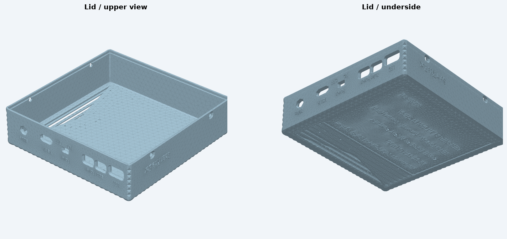
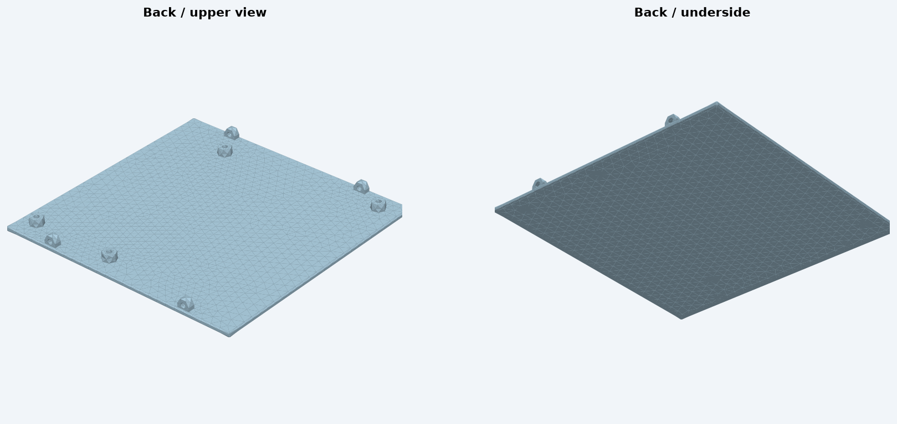
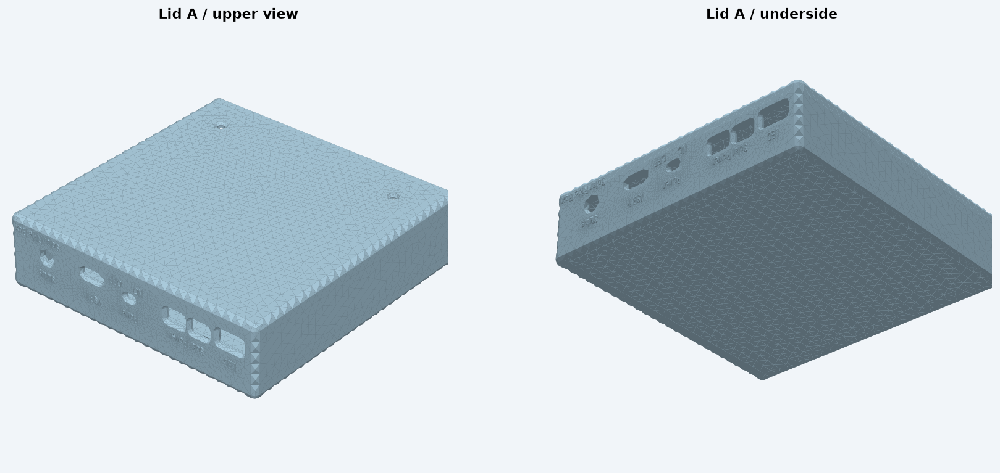
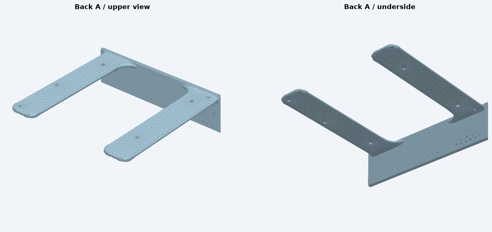

# 外壳版本

[English](../en/enclosure.md) · [首页](../../README.md)

## 已收录的模型

| 文件 | 几何结构判断 | 实物状态 |
| --- | --- | --- |
| `盒盖.stp` + `后盖.stp` | 主盒体配独立平板后盖，后盖带八个伸出的固定柱，对应螺丝固定方案 | 维护者确认螺丝固定款已打印 |
| `盒盖A.stp` + `后盖A.stp` | 主盒体配独立 U 形外框，对应抽拉外框方案 | 尚未打印 |

配对关系来自实际读取和渲染 STEP 几何结构，不是只按 A 后缀猜测。保留原中文文件名。模型作为设计源文件提供，螺丝规格、打印参数、间隙与装配效果仍需按自己的制作核对；四个 STEP 文件均成功导入为单一实体。

### 螺丝固定方案

### 抽拉外框方案

以上是模型渲染图，不是打印成品照片。请导入 CAD 或支持 STEP 的切片工具，按需自行导出 STL/3MF。核对模块和接头空间前，不建议直接缩放模型。模型本身未建立整机防水或材料耐温表现。
