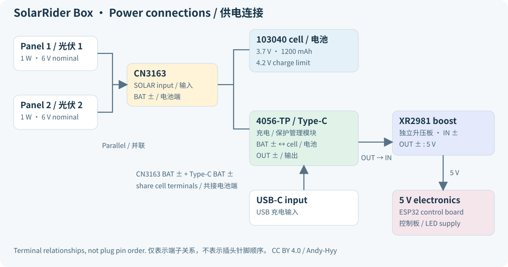

# 供电

[English](../en/power-wiring.md) · [首页](../../README.zh-CN.md) · [接线](hardware.md)

| 从 | 到 |
| --- | --- |
| 两块光伏板，同极 | CN3163 SOLAR，并联 |
| CN3163 BAT | 电池 |
| 4056-TP 电池端 | 同一节电池 |
| USB-C | 4056-TP 的 Type-C |
| 4056-TP OUT | XR2981 IN |
| XR2981 OUT | ESP32 的 5 V |

XR2981 的输入接自 4056-TP 的输出，而非电池。接入 ESP32 之前，已测得输出为 5 V。电池负极未与 4056-TP 的输出负极短接。
